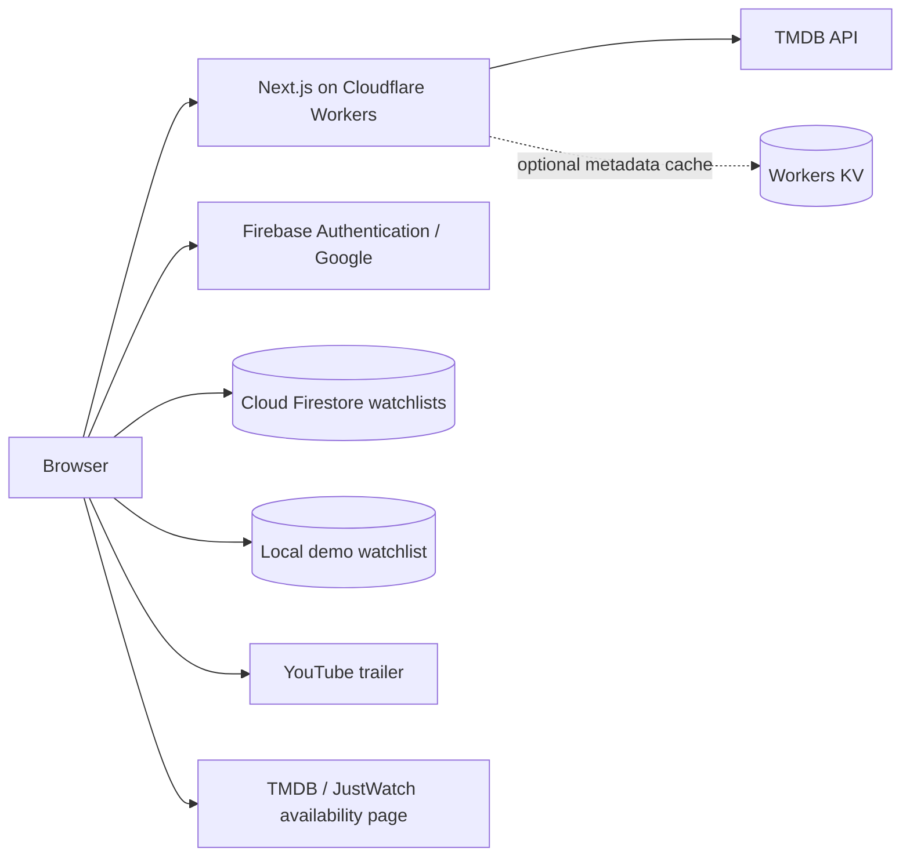

# Architecture and implementation scope

## Runtime

Pinflix is one full-stack Next.js 16 App Router application. Route handlers and server components run in the Node.js runtime; OpenNext adapts them to Cloudflare Workers with Node compatibility. Standard `next dev` supports the local demo. Workers preview supplies Cloudflare binding behavior and must be tested separately before deployment. [OpenNext runtime/version support](https://opennext.js.org/cloudflare).

## Data boundaries

- **Movie metadata:** fetched server-side from TMDB using `TMDB_READ_TOKEN`. Public responses contain normalized movie information, never the token. Demo data permits local discovery without the token and is identified as demo content.
- **Provider availability:** requested for a selected country. Missing country data means availability is unknown or absent in the source; it is not permission to invent a provider or stream URL. The returned TMDB availability link is the outbound destination. [TMDB watch providers](https://developer.themoviedb.org/reference/movie-watch-providers).
- **Trailers:** external YouTube embeds/links from accepted video metadata, with a restricted site, video type, and key format. The app does not serve full movie files.
- **Authentication:** Firebase Authentication owns Google sign-in and browser auth state. The Firebase Web SDK accesses Firestore directly; Firebase Security Rules scope account watchlists to `request.auth.uid`. No Firebase Admin credentials are exposed to the Worker or browser.
- **Account watchlists:** `users/{uid}/watchlist/{movieId}` stores a bounded movie-card snapshot and a server timestamp. Documents are private to their owner; the rules validate shape, size, and immutable ownership fields.
- **Demo saves:** local browser storage, scoped to its origin, without remote account identity. Demo mode does not pretend to authenticate a user.
- **Optional services:** `MOVIE_CACHE` provides metadata caching if bound. `MEDIA_BUCKET` is a future extension point for assets the operator may lawfully store. No R2 object upload or Cloudflare Stream integration is needed for the discovery MVP.

## Corrected assumptions from the supplied reports

| Report snippet/assertion | Implemented decision and reason |
| --- | --- |
| Static `output: "export"` alongside dynamic API routes | Keep the full Next.js server runtime; these routes need request-time server execution. |
| Build with `next build && next export`, deploy `out`, `.next`, or `dist` to Pages | Build Next.js, then adapt it with OpenNext to a Workers entry point and asset directory. |
| Force all routes to the Next.js Edge runtime | OpenNext uses the Node.js runtime with `nodejs_compat`. |
| Server-side database credentials in a browser app | Use the Firebase Web SDK and owner-scoped Firestore rules; do not ship Admin SDK credentials to the client. |
| Reported existing Pages/GitHub linkage means deployment is ready | No remote configuration is assumed or changed. Actual account/project access and resource IDs are deployment prerequisites. |
| Every Cloudflare feature is free or essential | Scope is discovery, auth, and watchlists. Product plans/limits must be checked for actual usage. |
| Stream/R2 movie delivery, queues, AI, real-time chat, payments | These are optional future work, not implemented streaming or monetization. |

## Security and operational scope

The app validates catalogue queries and movie identifiers, restricts external metadata destinations, and uses owner-only Firestore rules with strict document validation. Account data is never placed in the browser's guest storage. Catalogue/detail HTTP APIs use the `API_RATE_LIMITER` binding when available: a refused limit returns 429 with retry guidance, and a binding failure returns 503. Cloudflare supplies the client-IP header at its Worker boundary. The rate limit is approximate and per location, not a globally exact quota; ordinary Node demo mode has no limiter binding. HTTP headers constrain ordinary browser behavior; WAF and Turnstile need separate deliberate configuration.

Tests validate local code and mocks. They do not certify deployment configuration, Google consent approval, provider licensing, all accessibility criteria, or resistance to every attack. Production verification must include real authenticated persistence and separate-user isolation.
